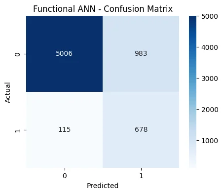
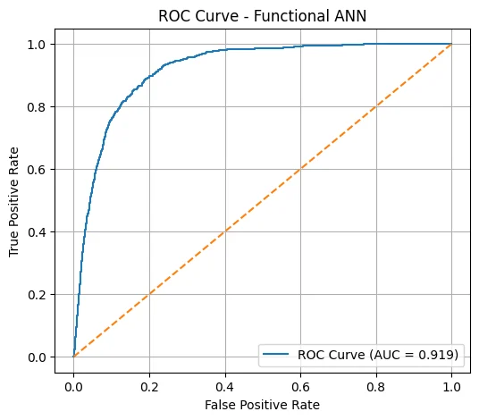
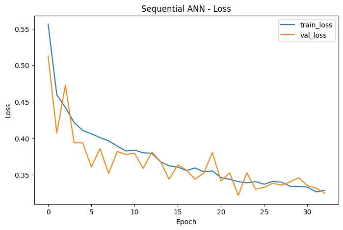
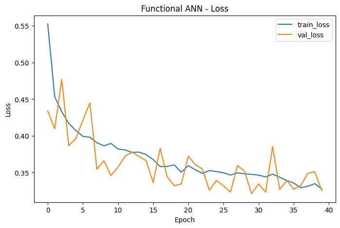
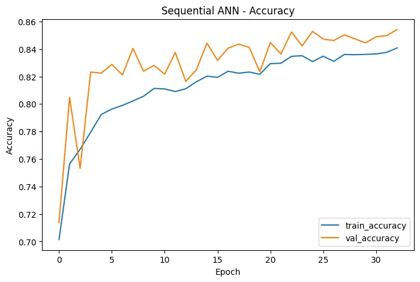
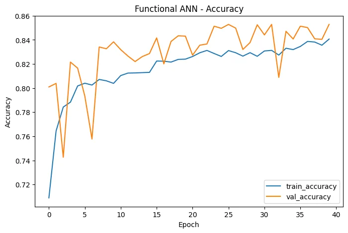
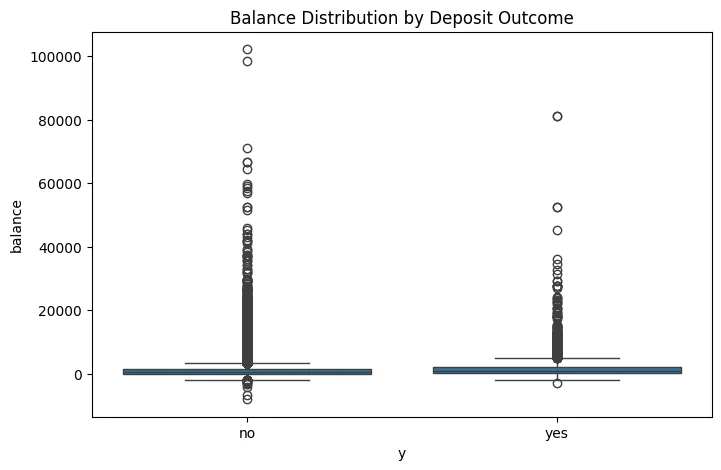
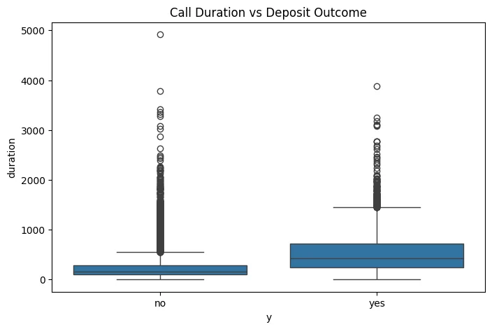

# Bank Marketing Subscription Prediction — Sequential vs Functional ANN

**Deep Learning coursework | Binary classification | TensorFlow/Keras | 45,211 campaign records**

This repository documents and preserves an Artificial Neural Network experiment on the **UCI Bank Marketing** dataset. Two networks with the **same 128–64–32 architecture** were implemented using the Keras **Sequential API** and **Functional API**. The project emphasizes exploratory data analysis (EDA), careful numerical/categorical preprocessing, data imbalance, reproducible splitting, and the precision–recall trade-off.

> **Important use limitation:** The saved models use `duration`, the length of the current marketing call. UCI explains that this attribute is not known before the call; the results are **retrospective call-outcome classification**, not validated pre-call lead scoring. Do not deploy these scores for targeting customers before a call without excluding `duration` and re-evaluating. There is no demonstrated production use or financial uplift.

## Key findings

| Metric on held-out test split | Sequential ANN | Functional ANN |
| --- | ---: | ---: |
| Accuracy | **0.840755** | 0.838101 |
| Precision (yes) | **0.411035** | 0.408188 |
| Recall (yes) | 0.836066 | **0.854981** |
| F1-score (yes) | 0.551122 | **0.552567** |
| ROC-AUC | 0.915079 | **0.918852** |
| Binary cross-entropy test loss (saved Keras output) | 0.348217 | **0.344654** |

The Functional ANN has marginally better recall, F1 and ROC-AUC, but both networks have the **same topology and optimizer settings**. Differences may reflect random initializations, stochastic optimization, and training execution; **the Functional API itself is not established as inherently superior**. Precision is about 41% because many predicted subscribers are false positives at the 0.5 decision threshold, in a dataset with only 11.7% positive examples and with substantial positive-class weighting.

## Data

- **Source:** [UCI Bank Marketing dataset (ID 222)](https://archive.ics.uci.edu/dataset/222/bank+marketing) — `bank-full.csv` from the older `bank.zip`, not `bank-additional-full.csv`.
- **Rows / columns:** 45,211 records; **16 input columns** and one target (`y`: yes/no).
- **Class distribution:** No: **39,922 (88.30%)**; Yes: **5,289 (11.70%)**.
- **Missingness:** No Pandas null values were reported; `unknown` categories and `pdays=-1` require domain-aware interpretation.
- **Citation:** Moro, S., Rita, P., & Cortez, P. (2014). *Bank Marketing* [Dataset]. UCI Machine Learning Repository. https://doi.org/10.24432/C5K306. The source dataset is distributed under **CC BY 4.0**.

For dataset download/setup, see [`data/README.md`](data/README.md). **The dataset is not committed in this repository.**

## Methodology

1. **EDA:** inspected class balance, customer age, account balance, employment, month, contact duration, loans, outliers and numeric correlations. `balance` was strongly skewed; extreme values were not deleted solely because an IQR rule flagged them.
2. **Stratified 70:15:15 split**, `random_state=42`: **31,647** training / **6,782** validation / **6,782** test rows. Test set has **793 yes** examples.
3. **Train-only preprocessing:** `RobustScaler` for 7 numeric fields and `OneHotEncoder(handle_unknown='ignore')` for 9 categorical fields, producing **51 transformed columns**. Transformation was fitted on train only.
4. **Class weights:** computed from training labels (`no` about **0.566**; `yes` about **4.274**) to emphasize subscriber recall.
5. **ANNs:** both use 128, 64, 32 ReLU hidden layers, `BatchNormalization`, dropout 0.30/0.25/0.20, L2 regularization, a single sigmoid output, Adam (learning rate 1e-3), binary cross-entropy, and maximum 100 epochs.
6. **Callbacks:** EarlyStopping, ModelCheckpoint, CSVLogger and ReduceLROnPlateau; results analyzed with confusion matrices, ROC and held-out classification metrics.

## Results and visual evidence

These visualizations are **original saved outputs extracted from the uploaded executed notebook** (not simulated charts or newly trained outputs).

### Classifying deposit subscribers






### Training behavior

| Sequential ANN | Functional ANN |
| --- | --- |
|  |  |
|  |  |

### Selected EDA outputs

| Class-related account balance | Contact duration by outcome |
| --- | --- |
|  |  |

Other graphs are under [`figures/eda/`](figures/eda/): age, job, month, numeric correlation and balance distribution.

## How to run

1. Install Python 3.10 or a compatible TensorFlow environment and create a virtual environment.
2. Install dependencies: `python -m pip install -r requirements.txt`.
3. Run **`python scripts/download_data.py`**. This places `bank-full.csv` in the notebook's directory (it is excluded from Git).
4. Open **`notebooks/bank_marketing_ann.ipynb`** with Jupyter and run the cells in order. The original notebook contains saved output, but reruns may differ due to stochastic training, versions, or local hardware.

Run the notebook in the `notebooks/` directory so that the relative path `'bank-full.csv'` resolves and callbacks write local files into `models/` and `logs/`.

## Repository structure

```text
notebooks/
  bank_marketing_ann.ipynb          # Topic-specific copy of original cells & outputs
figures/
  eda/                              # Original embedded EDA plots
  evaluation/                       # Original confusion matrices, histories, ROC
scripts/
  download_data.py                  # Dataset download helper authored for this repo
data/
  README.md                         # Data download, attribution & schema instructions
EXPERIMENT_EVIDENCE.md              # Provenance, limitations and rerun caveats
requirements.txt
.gitignore
```

## Evaluation limitations

- **`duration` leakage for pre-call use:** because duration is available only when the call is made, the achieved ROC-AUC **does not reflect pre-call prospect targeting**.
- **Time generalization not tested:** `bank-full.csv` was date-ordered in UCI's release; the notebook performed a stratified random rather than out-of-time split.
- **Class imbalance and threshold:** a high recall/low precision trade-off is partly influenced by class weights and decision threshold; precision near 41% should not be hidden by accuracy near 84%.
- **API comparison:** matched layer layouts do not establish statistically reliable advantages of one Keras interface; repeated-seed tests were not performed.
- **Execution provenance:** the original coursework notebook contained several unrelated questions. `notebooks/bank_marketing_ann.ipynb` is the topic-specific extract that preserves the Bank Marketing code and outputs, with one documented syntax correction to an incomplete import. The unmodified original is included as a **local-only backup outside the publishable repository folder** in the download ZIP.
- **No grade or deployment claim:** no verified course grade, model deployment, model registry, or operational marketing outcome is claimed.

## Distinction from another project

This experiment uses **45,211-row `bank-full.csv`** and deep neural networks. It is separate from the user's classical-ML **Bank Marketing Campaign Classification** project that uses a **41,188-row `bank-additional-full.csv`** variant, so the metrics are not directly comparable.

## Portfolio case study

[View the academic case study](https://hazel-portfolio-rose.vercel.app/projects/bank-marketing-ann)
